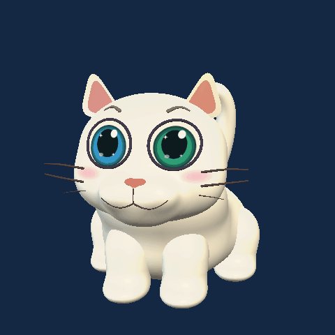

# Odd2U

A Windows 11 desktop cat companion built with C# and WPF 3D. Odd has a procedural animated model, a compact dashboard, optional local AI chat, and English/Mandarin voice commands.

<p align="center">
  
</p>

## Features

- Twelve actions, including walking, sitting, jumping, scratching and tail wiggles.
- Drag to move, right-drag to rotate, and scroll to resize.
- Sound, wandering, cursor following and window-edge perching controls.
- Local chat with Qwen3 1.7B through Ollama; review and delete saved conversations.
- Optional continuous voice commands with a microphone level meter.
- A dashboard that opens on the right half of the primary screen.

## Build and run

Requirements: Windows 11 on Intel/AMD x64, Windows .NET Framework 4.x with WPF and System.Speech, PowerShell, and Git. The build uses the framework C# compiler; no NuGet restore or .NET SDK is required.

```powershell
git clone https://github.com/samuellim83/Odd2U.git
cd Odd2U
.\build.ps1
.\build\Odd2U.exe
```

If PowerShell blocks the script, review the script and follow your computer's execution policy. The build outputs `build/Odd2U.exe` and its personality text file. `Launch Odd.cmd` opens that build.

Animations work without AI, an internet connection or a subscription. Quit Odd exits completely. Closing the dashboard keeps the cat running and stops microphone listening and any current reply.

## Optional AI

Install [Ollama](https://ollama.com), start it, and download the model:

```powershell
ollama pull qwen3:1.7b
```

Turn on Local AI in Odd and send a message. A source build uses Ollama at `127.0.0.1:11434`. Edit `odd-personality.txt` before building to customize the personality. Model weights and runtime binaries are not included in this repository.

An offline bundle can instead place the Ollama CPU runtime and model under `ai/` beside Odd2U.exe. That mode launches a private loopback server on demand and stops its process tree when AI is disabled or Odd exits. See [packaging/README.md](packaging/README.md).

## Voice commands

Enable Microphone and choose a language. Say “Odd, jump” or “奥德，跳一下”, then pause. Say “Odd, stop listening” or turn off the switch to stop.

Each PC needs compatible Windows desktop speech recognition language packs. A keyboard or text-to-speech voice alone is insufficient. Voice controls animations, not chat dictation. Accuracy depends on the microphone and speaker; nearby voices or recordings may trigger commands.

## Local data

Installed/source builds save settings and chat history under `%LOCALAPPDATA%\Odd2U`. A `portable.flag` file beside the executable switches storage to a local `Data` folder. Chat files are unencrypted XML. Audio is not saved or sent to the AI model. No telemetry or automatic Windows startup is added by Odd.

Do not commit or share your runtime data. The repository ignores personal data, build outputs, models, reference media and local tools.

## Verification

```powershell
.\tests\verify.ps1
.\build\Odd2U.exe --verify-ui output\ui
```

Geometry verification checks mesh validity, twelve poses and action transitions. UI verification renders layouts. Additional C# harnesses in `tests/` cover chat persistence, speech grammars, repeated commands and sound; some require an available local model. Full microphone, mixed-DPI and clean-device testing remain necessary.

## Source layout

- `src/OddModel.cs`, `src/Sculpt.cs`: procedural geometry and animations.
- `src/App.cs`, `src/Desktop.cs`: desktop lifecycle and integration.
- `src/Interface.cs`: dashboard and settings.
- `src/Chat.cs`, `src/Distribution.cs`: chat, storage and bundled AI lifecycle.
- `src/Voice.cs`, `src/PetSound.cs`: speech commands and synthesized sound.
- `src/Verification.cs`, `tests/`: verification utilities.
- `packaging/`: installer definition and offline bundle test.

## Status and licensing

This is a personal project and unsigned test software. The character uses articulated overlapping meshes, not a fully skinned production rig. Distribution has been tested locally, but not yet on a separate clean Windows 11 PC. An earlier reported antivirus detection was not conclusively diagnosed; do not disable protection if a build is blocked.

No open-source license has been selected for Odd2U yet. Public visibility does not grant a general reuse or redistribution license. Ollama and model files, when obtained separately, retain their respective third-party licenses.
